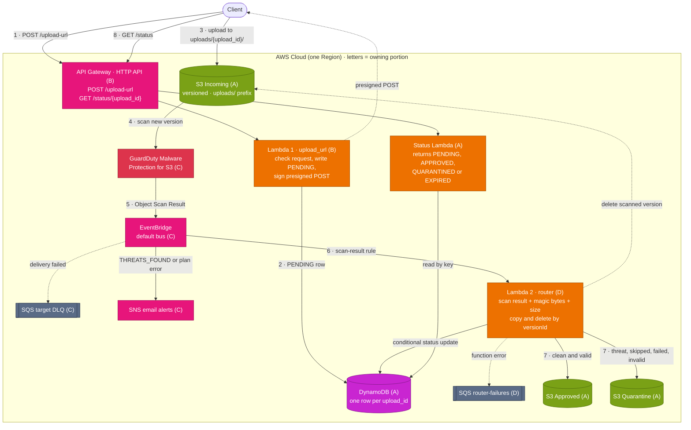

# AWS Secure File Upload Pipeline

A serverless pipeline that accepts file uploads, scans them for malware with GuardDuty, checks their real type and size, and sorts them into an Approved or Quarantine bucket. It's built entirely in Terraform by a team of four, one reviewed pull request at a time, and anyone can deploy it into their own AWS account.

**New to the project? Start with the [project overview](docs/overview.md)**: where the design came from, what changed and why, how the work is split, the tools, and how the check works. Each portion's details are in [`docs/portions/`](docs/portions/).

## Architecture

Solid arrows are the main flow, numbered in order. Dotted arrows are return and failure paths. The letter on each box is the portion of the team that owns it.



1. The client asks the API for an upload URL, giving the file's name, type, and size.
2. Lambda 1 checks the request, records it as `PENDING` in DynamoDB, and returns a presigned POST locked to `uploads/{upload_id}/{filename}`.
3. The client uploads straight to the Incoming bucket. The file never passes through API Gateway or Lambda.
4. GuardDuty Malware Protection for S3 scans the new object.
5. GuardDuty publishes the scan result to EventBridge.
6. An EventBridge rule invokes Lambda 2.
7. Lambda 2 checks the scan result, the file's magic bytes, and its real size. It then copies the exact scanned version to Approved or Quarantine, deletes it from Incoming, and updates DynamoDB.
8. The client polls `GET /status/{upload_id}` for the result.

## The team

| Portion | Owns | Milestones |
|---|---|---|
| A: Storage, Data, and Status | S3 buckets, DynamoDB, bucket policies, status endpoint | A1, A2, A3, A4 |
| B: Upload API and Observability | API Gateway, Lambda 1, dashboard and alarms | B1, B2, B3 |
| C: Scanning and Events | GuardDuty, EventBridge, DLQ, alerts | C1, C2, C3 |
| D: Processing | Lambda 2 (validation and routing), failure queue, redrive | D1, D2, D3, D4 |

M0 (repo foundation) and INT (integration) are shared milestones with one owner each.

## How we work

- **One branch per milestone**, named after it: `a1-buckets`, `b2-api`, and so on. Never commit to `main` directly. It's protected and only accepts reviewed PRs.
- **Read your brief first.** Every milestone has one in [`docs/milestones/`](docs/milestones/). It names the resources, variables, and settings to build, and links the docs. It doesn't give you the code.
- **Push to check.** Every push runs the check on GitHub: formatting, validation, your milestone's spec tests (taken from the branch name, so `a1-buckets` checks A1), and every milestone already merged. Results show on the commit, the PR, and the run's summary page under **Actions**. You want `👍`. The tests use a mocked AWS provider, so they touch no AWS account and cost nothing.
- **Re-run on demand.** `scripts/remote-check.sh` (or `scripts/remote-check.sh A1`) re-runs the check on GitHub for your pushed branch and streams the result to your terminal. It uses the [GitHub CLI](https://cli.github.com); the raw command is `gh workflow run ci.yml --ref <branch> -f milestone=A1`, then `gh run watch`.
- **Register your milestone.** Add its ID to `milestones.txt` in the same PR. CI re-checks every listed milestone on every PR, so nobody can break someone else's merged work without CI catching it.
- **Prove it in your account.** Each brief ends with a "Done when" step you run against real AWS. Paste its output into the PR.
- **One approval to merge.** Review means reading the diff against the brief, not only seeing a green check.
- **The test harness is lead-owned.** `tests/`, `scripts/`, `milestones.txt`, and `.github/` (which holds the check itself) are covered by CODEOWNERS, so changes there need the lead's review. A syntax error in any test file breaks every milestone's check, which is one reason these files are protected.

## Getting started

### 1. Get the code

Accept the collaborator invitation from your email, then:

```bash
git clone https://github.com/umbra-codex/aws-secure-file-upload.git
cd aws-secure-file-upload
```

Every command in this README and in the milestone briefs runs from this folder (the repo root).

### 2. Prerequisites

- [Terraform](https://developer.hashicorp.com/terraform/install) 1.10 or newer (CI uses 1.16.6). You need it for each milestone's "Done when" step, which deploys to your own account.
- The [GitHub CLI](https://cli.github.com), signed in with `gh auth login`, for on-demand checks.
- [AWS CLI v2](https://docs.aws.amazon.com/cli/latest/userguide/getting-started-install.html), signed in to **your own** AWS account (`aws sts get-caller-identity` should print your account).
- An [AWS Budget](https://docs.aws.amazon.com/cost-management/latest/userguide/budgets-create.html) alert (for example, $5) on that account **before** your first `apply`.

### 3. Bootstrap your state bucket (once)

Terraform keeps its state in an S3 bucket that you create by hand, once:

```bash
PROJECT=secure-upload        # must match project_name in your terraform.tfvars
ACCOUNT=$(aws sts get-caller-identity --query Account --output text)
BUCKET="${PROJECT}-${ACCOUNT}-tfstate"

aws s3api create-bucket --bucket "$BUCKET" --region us-east-1
aws s3api put-bucket-versioning --bucket "$BUCKET" --versioning-configuration Status=Enabled
aws s3api put-public-access-block --bucket "$BUCKET" \
  --public-access-block-configuration BlockPublicAcls=true,IgnorePublicAcls=true,BlockPublicPolicy=true,RestrictPublicBuckets=true
echo "$BUCKET"
```

In any region other than `us-east-1`, add `--create-bucket-configuration LocationConstraint=<region>` to `create-bucket`.

### 4. Configure and initialize

```bash
cp terraform.tfvars.example terraform.tfvars   # fill in project_name, owner, alert_email
cp backend.hcl.example backend.hcl             # set bucket to the name printed above
terraform init -backend-config=backend.hcl
terraform plan                                 # should plan with no errors
```

Both copied files are gitignored, so they never reach the repo.

## Milestones

Each brief lists the milestones it depends on. Briefs appear in `docs/milestones/` as each milestone opens.

| ID | What | Brief |
|---|---|---|
| M0 | Create the GitHub repo (lead only) | [M0.md](docs/milestones/M0.md) |
| A1 | The bucket module, called three times | [A1.md](docs/milestones/A1.md) |
| A2 | Expiration rules and the uploads table | [A2.md](docs/milestones/A2.md) |
| A3 | Bucket policies | [A3.md](docs/milestones/A3.md) |
| A4 | The status endpoint | [A4.md](docs/milestones/A4.md) |
| B1 | Lambda 1 and its role | [B1.md](docs/milestones/B1.md) |
| B2 | HTTP API and the upload size limit | [B2.md](docs/milestones/B2.md) |
| B3 | Throttling, CORS, alarms, dashboard | [B3.md](docs/milestones/B3.md) |
| C1 | GuardDuty Malware Protection plan | [C1.md](docs/milestones/C1.md) |
| C2 | Scan-result rule and DLQ | [C2.md](docs/milestones/C2.md) |
| C3 | Alerts | [C3.md](docs/milestones/C3.md) |
| D1 | Lambda 2 and its role | coming |
| D2 | Routing, failure queue, redrive | coming |
| D3 | File-type and size validation | coming |
| D4 | Idempotency and right-sizing | coming |
| INT | End-to-end tests in every account | coming |

## Cost and cleanup

Everything here is pay-per-use, and an idle stack costs close to nothing. GuardDuty Malware Protection bills per GB scanned, so test with small files. When you're done testing for the day:

```bash
terraform destroy
```

Your state bucket stays. Delete it by hand only when the project is over.

## Why bucket names include the account ID

S3 bucket names are global, so `<project>-<account_id>-<role>` keeps four teammates' deployments from colliding. An AWS account ID is an identifier, not a credential; AWS doesn't treat it as secret, and it can't be used to sign in.

## Why there's no VPC

Every service here (S3, Lambda, API Gateway, DynamoDB, EventBridge, GuardDuty, SQS, SNS) is a managed AWS endpoint reached over IAM-authenticated HTTPS. Nothing needs a private network, so a VPC would add cost and complexity without adding security.

## Repo layout

```
.
├── *.tf                 root module: one file per portion wires its module in
├── modules/             storage, status (A) · upload_api (B) · scanning (C) · processing (D)
├── modules/*/src/       Lambda source code, inside the module that deploys it (A4, B1, D1)
├── tests/               one spec test per milestone (*.tftest.hcl)
├── scripts/             remote-check.sh: re-run the CI check on demand
├── .github/             CI workflow and the check it runs (lead-owned)
├── milestones.txt       milestones merged so far (CI checks all of them)
└── docs/                overview.md, portions/ (one doc per portion), milestones/ (one brief per milestone)
```

## A note for OpenTofu users

`.terraform.lock.hcl` should be the one Terraform generates. `tofu init` rewrites it for the OpenTofu registry, so don't commit lock-file changes from `tofu`.
