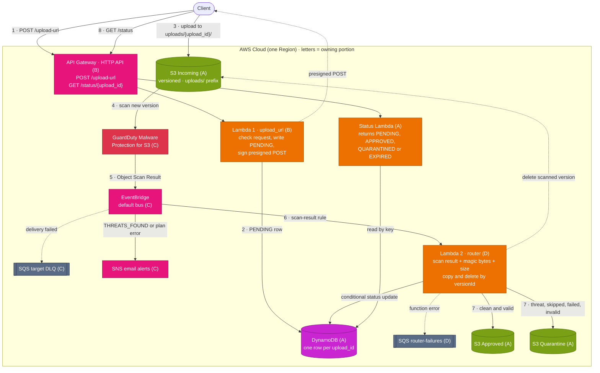

# AWS Secure File Upload Pipeline: Project Overview

A serverless pipeline that takes file uploads, scans them for malware, checks their real type and size, and sorts them into an **Approved** or **Quarantine** bucket. Four people build it in Terraform, one reviewed pull request at a time. Anyone can deploy the finished stack into their own AWS account.

## Where it started

The first design (a teammate's diagram) had the right core:

> Client → API Gateway → **Lambda 1** (checks the request, creates a presigned POST) → client uploads to **S3 Incoming** → **GuardDuty** scans it → **EventBridge** → **Lambda 2** (validates and routes) → **S3 Approved** or **S3 Quarantine**, with results in **DynamoDB**.

## What changed, and why

We kept that flow and filled the gaps a design review found, checking each change against the [AWS Well-Architected Framework](https://docs.aws.amazon.com/wellarchitected/latest/framework/the-pillars-of-the-framework.html):

| Change | Why | Pillar |
|---|---|---|
| Every scan result except "clean" goes to Quarantine | GuardDuty can also return unsupported, access-denied, or failed; the original only handled clean vs malware | Security |
| Lambda 2 copies and deletes the **exact file version** GuardDuty scanned | Otherwise a file swapped after the scan could reach Approved unscanned | Security |
| Files are named `uploads/{upload_id}/{safe_filename}` (Lambda 1 strips `/`, `..`, and control characters) | Links each file to its DynamoDB row; clients can't overwrite each other's uploads | Security, Reliability |
| A `GET /status/{upload_id}` endpoint | The client had no way to learn the result | Operational excellence |
| Two failure queues (EventBridge DLQ and Lambda 2's failure queue) plus a redrive script | Failed events were lost silently; now they're captured and can be replayed | Reliability |
| Least-privilege IAM role per Lambda; bucket policies deny non-HTTPS and lock Quarantine | The original diagram had no security controls | Security |
| Abandoned uploads expire: a row still `PENDING` 75 minutes after creation is deleted by DynamoDB TTL. Incoming empties after 1 day, Quarantine after 30 | Rows and files clean themselves up with no job to run, while finished uploads stay queryable | Cost optimization, Sustainability |
| Serverless only, `arm64` Lambdas, on-demand DynamoDB, 14-day logs | Pay only for use; no servers; cheaper compute | Cost optimization, Performance efficiency, Sustainability |
| Alerts by email on malware or scanner errors, and a dashboard | Problems get noticed | Operational excellence |

**Encryption and scanning.** SSE-S3 on every bucket. Never SSE-C: GuardDuty can't scan it, so every file would land in Quarantine. SSE-KMS is a stretch goal and needs key grants for the router and the GuardDuty role. GuardDuty's S3 malware plan works without a GuardDuty detector, so it won't clash with an account that already has GuardDuty on. Only Incoming is versioned, because copying the exact scanned version needs it.

**No VPC.** Every service is a managed AWS endpoint reached over IAM-authenticated HTTPS, so a private network would add cost without adding security.

## Well-Architected, in one screen

| Pillar | What we do |
|---|---|
| Security | Least-privilege role per function; HTTPS-only buckets; SSE-S3; Quarantine readable only by the router; scan first, then check type and size |
| Reliability | Two failure queues plus redrive; DynamoDB point-in-time recovery; copy by the scanned version |
| Operational excellence | Dashboard and alarms; structured logs carrying `upload_id`; API access logs; CI gates every PR |
| Performance efficiency | Files go straight to S3; 16-byte type checks; server-side copy; on-demand table |
| Cost optimization | Pay-per-use; TTL and lifecycle cleanup; budget alert; `destroy` after testing |
| Sustainability | `arm64`; managed services; 14-day logs; scanning limited to `uploads/` |

## How it works now

Solid arrows are the flow, dotted arrows are returns and failures, and the letter on each box is the portion that owns it.

1. The client asks for an upload URL (`POST /upload-url`).
2. Lambda 1 checks the request, cleans the filename, records it as `PENDING`, and returns a presigned POST locked to one key, one size range, and 15 minutes.
3. The client uploads straight to Incoming; the file never passes through API Gateway or Lambda.
4. GuardDuty scans the new file.
5. The scan result goes to EventBridge.
6. EventBridge invokes Lambda 2 asynchronously (which is why Lambda 2 has its own failure queue).
7. Lambda 2 checks the scan result, the file's real type (its first bytes), and its size, then moves the scanned version to Approved or Quarantine and updates DynamoDB.
8. The client polls `GET /status/{upload_id}`.

## How the work is split

| Portion | Owner | Builds | Milestones |
|---|---|---|---|
| [A: Storage, Data, and Status](portions/a-storage-data-and-status.md) | Sean (@umbra-codex) | S3 buckets, DynamoDB, bucket policies, status endpoint | A1-A4 |
| [B: Upload API and Observability](portions/b-upload-api-and-observability.md) | Bright (@Bright-Daniels13) | API Gateway, Lambda 1, dashboard, alarms | B1-B3 |
| [C: Scanning and Events](portions/c-scanning-and-events.md) | Rizuanul (@rizuanul90) | GuardDuty, EventBridge, failure queue, alerts | C1-C3 |
| [D: Processing](portions/d-processing.md) | Baltazar (@blaborte) | Lambda 2, failure queue, redrive | D1-D4 |

Each portion has a doc in `docs/portions/`, and every milestone has a brief in `docs/milestones/<ID>.md`. Every brief exists today: M0, A1 to A4, B1 to B3, C1 to C3, D1 to D4, and INT. Sean is the lead: he sets up the repo ([M0](milestones/M0.md)) and owns the briefs and tests. A different teammate leads **INT**, the final end-to-end test.

**Schedule** (merge in this order within each week):

| Week | Milestones |
|---|---|
| 0 | M0 (repo setup); everyone creates their state bucket |
| 1 | A1 → A2 → B1, C1, D1 (those three in any order once A2 is merged) |
| 2 | B2, D2; C2 (needs C1 and D1) |
| 3 | A3 (needs D1), D3, C3, A4 (needs B2) |
| 4 | B3 (needs C2 and D2), D4 → INT |

Plan about 45 minutes to review C1, D2, and A3; they're the security-heavy ones.

## Tools

| Tool | Used for |
|---|---|
| Terraform 1.10+ (CI uses 1.16.6) | Builds everything. 1.10 is the minimum for S3-native state locking. OpenTofu works locally, but PRs must pass the Terraform check, and never commit the lock file `tofu init` rewrites. |
| AWS CLI v2 | Run `aws configure sso` (or `aws configure`) once; Terraform and the "Done when" checks use those credentials. `aws sts get-caller-identity` confirms which account you're in. |
| Git and the GitHub CLI (`gh`) | Branches, pushes, pull requests, re-running the check |
| VS Code + HashiCorp Terraform extension | Editing, with mistakes highlighted as you type |
| Python 3.13 (in Lambda) | The three Lambda functions |
| AWS providers | `hashicorp/aws` ~> 6.69, `hashicorp/archive` ~> 2.8 (zips Lambda code) |

## How each milestone works

1. **Branch:** `git checkout -b a1-buckets` (one branch per milestone, named exactly as its brief says; CI reads the milestone from the name, so a name like `feature/a1` gets no dependency check and runs no spec tests). No forks during the build.
2. **Build file by file** following the brief in `docs/milestones/<ID>.md`. It names every resource, argument, and value, and links the docs, but gives no code.
3. **Checkpoint after each file:** `terraform fmt -recursive`, commit, push. The first checkpoint also opens a **draft** pull request. Commit messages follow [Conventional Commits](https://www.conventionalcommits.org/en/v1.0.0/) (`feat(b1): add upload handler`); A1's [Commit messages](milestones/A1.md#commit-messages) explains the format.
4. **"Done when":** `terraform apply` in your own AWS account, run the brief's checks, then `terraform destroy`.
5. **Finish:** add the milestone ID to `milestones.txt`, paste the "Done when" output into the PR, fill in the template's "What broke and why" (two lines; "nothing" is fine), and run `gh pr ready`. A teammate approves, and it merges into `main`. Reviewing means reading the diff against the brief, not only seeing a green check.

## The GitHub Actions check

- **When it runs:** on every push to any branch. To re-run without pushing: `scripts/remote-check.sh`, which prints "N of N steps done" and what to fix next.
- **Forks:** CI runs on branches of this repo only. A pull request from a fork gets no check and cannot merge, so work in a branch of this repo.
- **Dependencies:** before the spec tests, CI reads the "Depends on" row of your brief and compares it with `milestones.txt` on `main`. A dependency that is merged on `main` but not yet in your branch fails with `git fetch origin && git merge origin/main`; one that is not merged anywhere yet fails with its ID. The spec tests are mocked, so they would pass without the dependency; this step is what stops an early start from reaching review. A brief whose row is missing or malformed fails the check too, naming the brief: the row is the gate's input, so `docs/milestones/` needs the lead's review like `milestones.txt` does.
- **Next up:** `.github/workflows/next.yml` keeps one issue per milestone in step with `milestones.txt` on `main`, on every push to `main` and every six hours. When the last dependency of a milestone merges, it opens "<ID> is ready", assigned to that portion's owner from `.github/owners.txt`; GitHub emails the assignee. The issue holds the brief, the exact branch name, and the start commands. Each notice carries the `ready-notice` label, which is how the workflow recognises its own issues: renaming one keeps it tracked, and one closed before its milestone merged is reopened on the next run. If the owner cannot be assigned yet (invitation not accepted), the issue opens unassigned and gets its assignee at the next run once they accept. It closes itself when the milestone merges. To re-run by hand: Actions, next, "Run workflow" (from any branch; it always reads `main`).
- **What it checks:** formatting, `init`, `validate`, then the milestone's spec tests one file at a time (so you see your progress step by step), then every milestone already listed in `milestones.txt` (so nobody can break merged work), then `tflint` with the AWS ruleset. One tflint rule, `terraform_unused_declarations`, is off until INT, because modules declare inputs before the milestone that uses them.
- **How:** Terraform's built-in `terraform test` with a **mocked AWS provider**. It needs no AWS account and costs nothing. It proves the code matches the spec; "Done when" proves it works in real AWS.
- **Where results live:** on GitHub only, under **Actions** and on the pull request. Nothing runs on or is saved to your machine.
- **Protected:** `main` requires a pull request, a passing check, and one approval. The tests and the check itself (`tests/`, `scripts/`, `.github/`, `milestones.txt`, `docs/milestones/`) need Sean's approval to change.

## Deploying into your own account

- Create your own state bucket once (repo README, "Getting started"), copy `terraform.tfvars.example` and `backend.hcl.example`, and run `terraform init -backend-config=backend.hcl`.
- Nothing is hardcoded: names include your project name and account ID, so four teammates' deployments never collide.
- **Cost:** everything is pay-per-use. Set an AWS Budget alert (for example, $5) before your first `apply`, test with small files (GuardDuty bills per GB scanned), and `terraform destroy` when you're done.
- **Security:** the repo is public. Never commit `terraform.tfvars`, `backend.hcl`, state files, or keys (`.gitignore` blocks them). Never weaken Block Public Access to make an upload work; presigned uploads work without it.

## Final integration test (INT)

Test 1 is the gate: if a clean file doesn't reach Approved, stop and check the scanner before reading anything into tests 2 to 4.

1. Clean file → Approved; status `APPROVED`.
2. EICAR test file (a harmless file every scanner flags) → Quarantine; `reason` is exactly `THREATS_FOUND`.
3. Password-protected zip → Quarantine; `reason` is `UNSUPPORTED`.
4. Renamed `.exe` → Quarantine; `reason` is `INVALID_TYPE`.
5. Oversize upload → S3 rejects the presigned POST itself.
6. Recovery: remove the router's `s3:PutObject` on Approved and apply. Upload a clean file; the row stays `PENDING` and `router-failures` holds 1 message. Restore the permission, run `scripts/redrive.sh`, confirm `APPROVED`.
7. `terraform plan` shows no changes.
8. Request a URL and don't upload; after it expires, status is `EXPIRED`.

The INT lead runs all 8 and pastes the output into the INT PR. Everyone else runs 1, 2, and 7 in their own account, then `destroy`. INT also adds the README runbook ("a file was quarantined, now what") and turns `terraform_unused_declarations` back on.

Stretch goal after INT: a review in the AWS Well-Architected Tool (Serverless Lens), committed to the repo.

## Shared contracts

Every portion builds against these. Change one only with the whole team.

**File key:** `uploads/{upload_id}/{safe_filename}`. Lambda 1 picks `upload_id` (a UUID).

**DynamoDB item:**

| Attribute | Values | Set by |
|---|---|---|
| `upload_id` (key) | UUID | Lambda 1 |
| `filename`, `declared_type`, `declared_size` | from the request | Lambda 1 |
| `status` | `PENDING`, `APPROVED`, `QUARANTINED` (`EXPIRED` is computed when read) | Lambda 1, Lambda 2 |
| `reason` | `THREATS_FOUND`, `UNSUPPORTED`, `ACCESS_DENIED`, `FAILED`, `INVALID_TYPE`, `TOO_LARGE`, `STALE` | Lambda 2 |
| `scanned_version_id`, `destination_bucket` | from the scan and the move | Lambda 2 |
| `created_at` | ISO 8601 time | Lambda 1 |
| `expires_at` | a **Number**, Unix seconds: now + 15 minutes + 1 hour (TTL ignores strings). Removed by Lambda 2 when it sets the final status. | Lambda 1 sets it; Lambda 2 removes it |

**Decided (Sean, 2026-10-21):** finished uploads stay queryable. Lambda 2 removes `expires_at` in the same update that sets `APPROVED` or `QUARANTINED`, so DynamoDB TTL only deletes uploads that never finished. A `PENDING` row past its `expires_at` reads as `EXPIRED` until TTL removes it, then `404`.

**Module interface:**

| Module (owner) | Gives others | Needs from others |
|---|---|---|
| storage (A) | 3 bucket names and ARNs, table name and ARN | `router_role_arn` (D) |
| status (A) | `status_role_arn`, `status_function_name`, `status_route_key` | table (A), `api_id`, `api_execution_arn` (B) |
| upload_api (B) | `api_url`, `api_id`, `api_execution_arn`, `upload_role_arn` | Incoming bucket and table (A); queue names (C, D) for the dashboard |
| scanning (C) | `guardduty_role_arn`, `scan_rule_arn`, `dlq_arn`, `dlq_name`, `alerts_topic_arn` | Incoming bucket (A), `router_lambda_arn` (D) |
| processing (D) | `router_lambda_arn`, `router_function_name`, `router_role_arn`, failure queue name and URL | 3 buckets and table (A) |

Storage takes `router_role_arn` from processing, and processing takes the bucket names from storage. Terraform tracks dependencies per value, not per module, so that isn't a cycle. The one rule: no storage output may be computed from `router_role_arn`, or `plan` fails with a cycle. Module outputs start as placeholder strings; each milestone PR replaces its own.

**Permissions** (each role gets only these):

| Role | Allowed |
|---|---|
| upload (B) | `s3:PutObject` on `incoming/uploads/*`; `dynamodb:PutItem` on the table |
| status (A) | `dynamodb:GetItem` on the table |
| router (D) | `s3:GetObject`, `s3:GetObjectVersion`, `s3:GetObjectTagging`, `s3:GetObjectVersionTagging`, `s3:DeleteObjectVersion` on Incoming; `s3:PutObject`, `s3:PutObjectTagging` on Approved and Quarantine; `dynamodb:GetItem`, `dynamodb:UpdateItem` on the table; `sqs:SendMessage` on router-failures |
| GuardDuty plan (C) | the policy from AWS's "Adding IAM policy permissions" page |
| every Lambda | `logs:CreateLogStream`, `logs:PutLogEvents` on its own log group |

Every allow lives on the role's own policy; bucket policies only deny. All three buckets deny any request not using HTTPS, and only the router may read Quarantine. EventBridge gets permission on C's queue and topic through their resource policies.

## Sources

- [AWS Well-Architected Framework: the pillars](https://docs.aws.amazon.com/wellarchitected/latest/framework/the-pillars-of-the-framework.html)
- [GuardDuty Malware Protection for S3](https://docs.aws.amazon.com/guardduty/latest/ug/gdu-malware-protection-s3.html)
- [S3 scan results in EventBridge](https://docs.aws.amazon.com/guardduty/latest/ug/monitor-with-eventbridge-s3-malware-protection.html)
- [EventBridge dead-letter queues](https://docs.aws.amazon.com/eventbridge/latest/userguide/eb-rule-dlq.html)
- [Lambda asynchronous invocation records](https://docs.aws.amazon.com/lambda/latest/dg/invocation-async-retain-records.html)
- [HashiCorp module creation pattern](https://developer.hashicorp.com/terraform/tutorials/recommended-patterns/pattern-module-creation)
